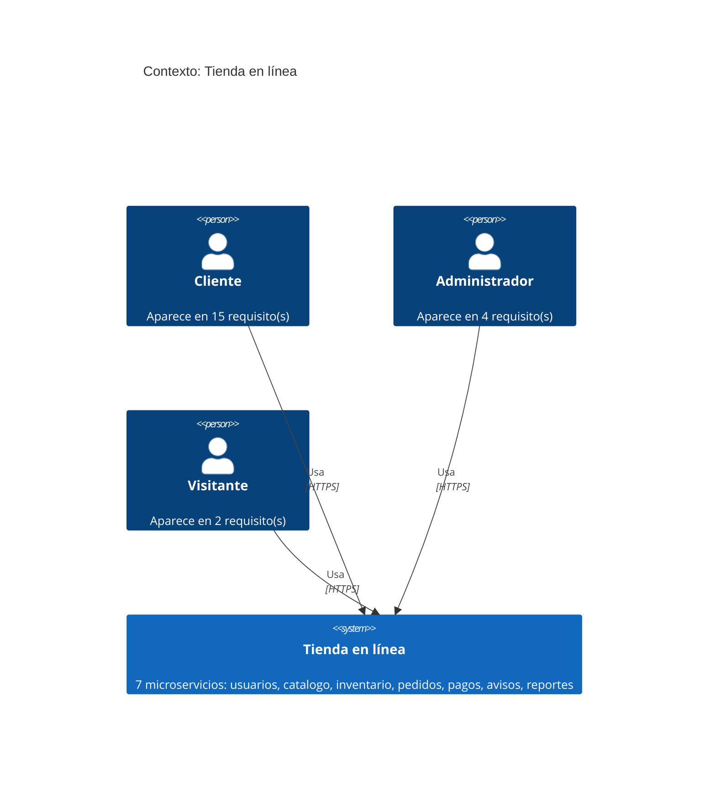
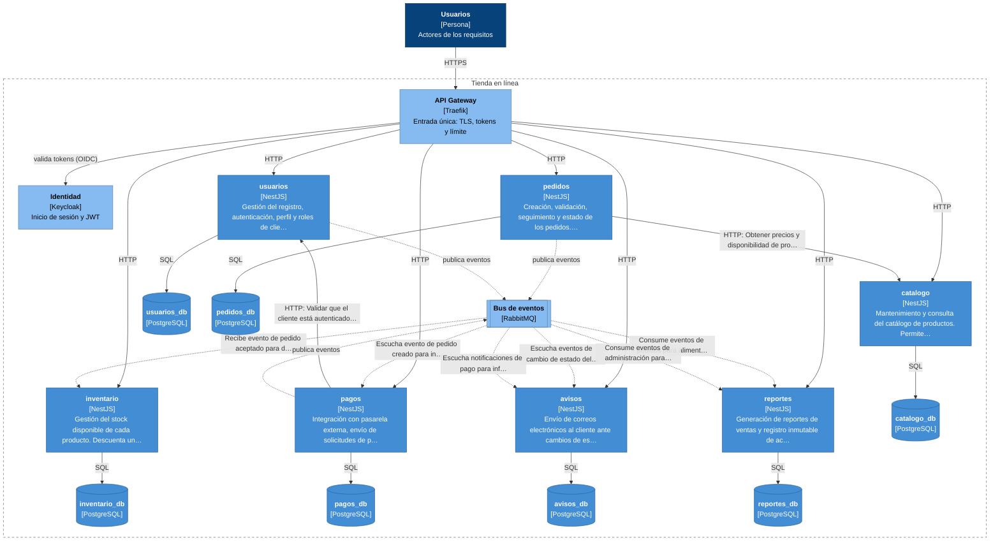

<!-- Generado por el framework (framework arquitectura adr). Se regenera: no lo edites. -->
# Arquitectura: Tienda en línea

Generada el 2026-11-11 por el framework a partir de `arquitectura.json`, validada por OPA, para el documento requisitos.docx (SHA-256 `0515668b00b8`). Los diagramas siguen el modelo C4 y GitHub los dibuja a partir del texto Mermaid.

Para regenerarla:

```bash
framework arquitectura diagrama <arquitectura.json> --requisitos <modelo_requisitos.json> --nombre "<nombre del sistema>"
```

## 1. Contexto

Quién usa el sistema. Los actores salen de los requisitos del documento.



## 2. Contenedores

Las piezas que forman el sistema y cómo se comunican. Las flechas «HTTP» entre servicios son llamadas síncronas (el que llama espera la respuesta); las «AMQP» pasan por el bus de eventos (el que publica no espera a nadie).



## 3. Servicios

| Servicio | Contexto | Responsabilidad | Base de datos | Requisitos | Etiquetas de seguridad |
|---|---|---|---|---|---|
| `usuarios` | Gestión de usuarios | Gestión del registro, autenticación, perfil y roles de clientes y administradores. Incluye activación por email, bloqueo por intentos fallidos, logout, edición de datos personales y eliminación de cuenta. | `usuarios_db` | RF-01, RF-02, RF-03, RF-04, RNF-01, RNF-04, RF-20 | autenticacion, limite\_peticiones, control\_acceso\_recursos, hash\_password, autorizacion |
| `catalogo` | Catálogo de productos | Mantenimiento y consulta del catálogo de productos. Permite búsqueda paginada, visualización de detalles, creación/edición/borrado por administradores y preservación de productos retirados en pedidos. | `catalogo_db` | RF-05, RF-06, RF-07, RF-08, RNF-08 | validacion\_entrada |
| `inventario` | Control de stock | Gestión del stock disponible de cada producto. Descuenta unidades al aceptar un pedido y devuelve unidades al cancelar o expirar pedidos. | `inventario_db` | RF-12 | ninguna |
| `pedidos` | Gestión de pedidos | Creación, validación, seguimiento y estado de los pedidos. Calcula precios a partir del catálogo, verifica disponibilidad, permite cancelación antes de envío y controla flujo de estados. | `pedidos_db` | RF-09, RF-10, RF-11, RF-13, RF-15, RF-17, RF-19 | validacion\_entrada, control\_acceso\_recursos, autorizacion |
| `pagos` | Procesamiento de pagos | Integración con pasarela externa, envío de solicitudes de pago y recepción de notificaciones de resultado. Actualiza estado del pedido a pagado tras validar la notificación. | `pagos_db` | RF-14, RNF-02 | validacion\_entrada |
| `avisos` | Notificaciones | Envío de correos electrónicos al cliente ante cambios de estado del pedido y eventos de pago. | `avisos_db` | RF-16 | ninguna |
| `reportes` | Reportes y auditoría | Generación de reportes de ventas y registro inmutable de acciones de administradores sobre productos y pedidos. | `reportes_db` | RF-18, RNF-03 | autorizacion, auditoria |

Requisitos transversales, que aplican a todo el sistema: RNF-05, RNF-06, RNF-07, RNF-09, RNF-10 (etiquetas: cifrado\_transito, punto\_unico\_acceso, limite\_peticiones).

## 4. Dependencias entre servicios

| Servicio | Depende de | Tipo | Para qué |
|---|---|---|---|
| `inventario` | `pedidos` | asíncrona (eventos) | Recibe evento de pedido aceptado para descontar stock y de pedido cancelado para devolver stock |
| `pedidos` | `catalogo` | síncrona (HTTP) | Obtener precios y disponibilidad de productos al crear o validar un pedido |
| `pagos` | `pedidos` | asíncrona (eventos) | Escucha evento de pedido creado para iniciar proceso de pago |
| `pagos` | `usuarios` | síncrona (HTTP) | Validar que el cliente está autenticado antes de iniciar pago |
| `avisos` | `pedidos` | asíncrona (eventos) | Escucha eventos de cambio de estado del pedido para enviar notificaciones |
| `avisos` | `pagos` | asíncrona (eventos) | Escucha notificaciones de pago para informar al cliente |
| `reportes` | `pedidos` | asíncrona (eventos) | Consume eventos de pedidos para alimentar reportes y auditoría |
| `reportes` | `usuarios` | asíncrona (eventos) | Consume eventos de administración para auditoría |

## 5. Patrones aplicados

| Patrón | Implementación | Por qué lo infiere OPA | ADR |
|---|---|---|---|
| Database per Service | prisma\_postgresql | Cada servicio tiene su propia base de datos | [ver ADR](adr/0006-aplicar-el-patron-database-per-service.md) |
| Event-Driven | rabbitmq | Dependencias por eventos: avisos -&gt; pagos, avisos -&gt; pedidos, inventario -&gt; pedidos, pagos -&gt; pedidos, reportes -&gt; pedidos, reportes -&gt; usuarios | [ver ADR](adr/0007-aplicar-el-patron-event-driven.md) |
| API Gateway | traefik | Hay requisitos de autenticación y varios servicios: se autentica una sola vez, en la entrada; Hay requisitos de punto único de entrada o de límite de peticiones | [ver ADR](adr/0008-aplicar-el-patron-api-gateway.md) |
| Circuit Breaker | nestjs\_interceptor\_con\_reintentos\_y\_timeout | Llamadas síncronas entre servicios: pagos -&gt; usuarios, pedidos -&gt; catalogo | [ver ADR](adr/0009-aplicar-el-patron-circuit-breaker.md) |
| Saga | rabbitmq | pagos coordina operaciones que involucran a otros servicios | [ver ADR](adr/0010-aplicar-el-patron-saga.md) |

## 6. Validación de OPA

Arquitectura aprobada: cumple los 4 criterios; patrones inferidos: api\_gateway, circuit\_breaker, database\_per\_service, event\_driven, saga

| Regla | Cumple | Detalle |
|---|---|---|
| `arquitectura.base_datos_propia` | sí | Cada servicio tiene su propia base de datos (Database per Service) |
| `arquitectura.sin_ciclos` | sí | Las dependencias entre servicios no forman ciclos |
| `arquitectura.dependencias_conocidas` | sí | Cada dependencia apunta a otro servicio de la arquitectura |
| `arquitectura.servicios_unicos` | sí | Hay al menos un servicio y no hay nombres repetidos |
