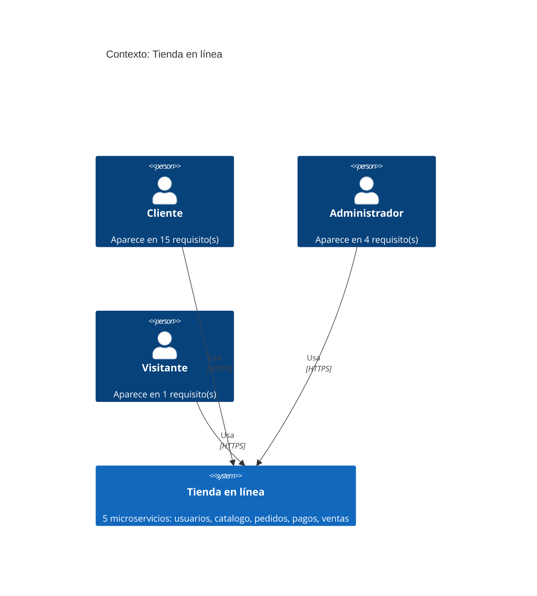
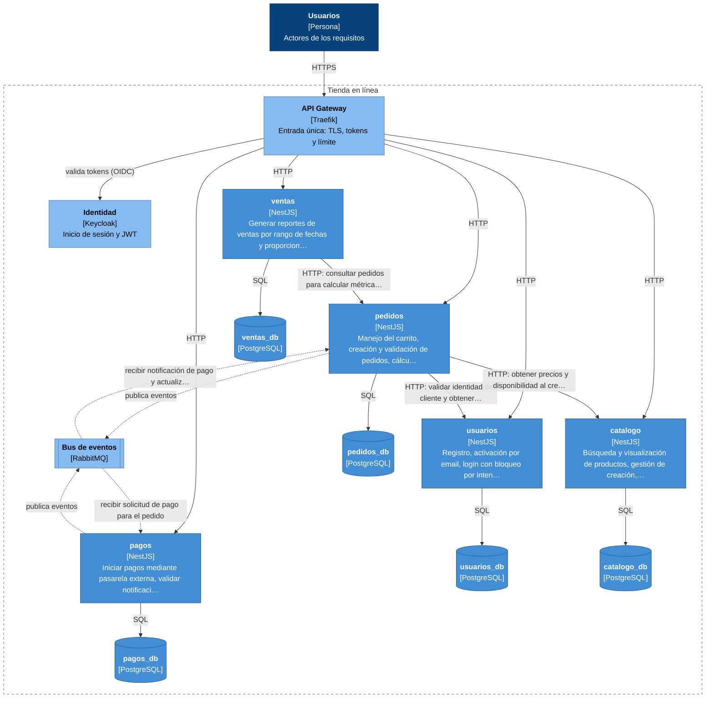

<!-- Generado por el framework (framework arquitectura adr). Se regenera: no lo edites. -->
# Arquitectura: Tienda en línea

Generada el 2026-11-14 por el framework a partir de `arquitectura.json`, validada por OPA, para el documento requisitos.docx (SHA-256 `0515668b00b8`). Los diagramas siguen el modelo C4 y GitHub los dibuja a partir del texto Mermaid.

Para regenerarla:

```bash
framework arquitectura diagrama <arquitectura.json> --requisitos <modelo_requisitos.json> --nombre "<nombre del sistema>"
```

## 1. Contexto

Quién usa el sistema. Los actores salen de los requisitos del documento.



## 2. Contenedores

Las piezas que forman el sistema y cómo se comunican. Las flechas «HTTP» entre servicios son llamadas síncronas (el que llama espera la respuesta); las «AMQP» pasan por el bus de eventos (el que publica no espera a nadie).



## 3. Servicios

| Servicio | Contexto | Responsabilidad | Base de datos | Requisitos | Etiquetas de seguridad |
|---|---|---|---|---|---|
| `usuarios` | Gestión de Usuarios y Autenticación | Registro, activación por email, login con bloqueo por intentos fallidos, gestión de perfil, logout, eliminación de cuenta y manejo seguro de credenciales. | `usuarios_db` | RF-02, RF-03, RF-04, RF-05, RNF-01, RF-21 | autenticacion, limite\_peticiones, control\_acceso\_recursos, hash\_password, autorizacion, auditoria |
| `catalogo` | Catálogo de Productos | Búsqueda y visualización de productos, gestión de creación, modificación y retiro de productos por administradores, manejo de fotos y disponibilidad. | `catalogo_db` | RF-06, RF-07, RF-08, RF-09, RNF-08 | validacion\_entrada |
| `pedidos` | Gestión de Pedidos y Carrito | Manejo del carrito, creación y validación de pedidos, cálculo de precios, control de stock, flujo de estados del pedido, cancelación, generación de eventos de pago y auditoría. | `pedidos_db` | RF-01, RF-10, RF-11, RF-12, RF-13, RF-14, RF-16, RF-17, RF-18, RF-20 | validacion\_entrada, control\_acceso\_recursos, autorizacion |
| `pagos` | Procesamiento de Pagos | Iniciar pagos mediante pasarela externa, validar notificaciones firmadas, registrar resultados y emitir eventos de pago aceptado o rechazado. | `pagos_db` | RNF-02, RF-15 | validacion\_entrada |
| `ventas` | Reportes y Analítica de Ventas | Generar reportes de ventas por rango de fechas y proporcionar datos a los administradores. | `ventas_db` | RF-19 | ninguna |

Requisitos transversales, que aplican a todo el sistema: RNF-03, RNF-04, RNF-05, RNF-06, RNF-07, RNF-09, RNF-10 (etiquetas: auditoria, autorizacion, cifrado\_transito, punto\_unico\_acceso, limite\_peticiones).

## 4. Dependencias entre servicios

| Servicio | Depende de | Tipo | Para qué |
|---|---|---|---|
| `pedidos` | `usuarios` | síncrona (HTTP) | validar identidad del cliente y obtener datos de cuenta |
| `pedidos` | `catalogo` | síncrona (HTTP) | obtener precios y disponibilidad al crear el pedido |
| `pedidos` | `pagos` | asíncrona (eventos) | recibir notificación de pago y actualizar estado del pedido |
| `pagos` | `pedidos` | asíncrona (eventos) | recibir solicitud de pago para el pedido |
| `ventas` | `pedidos` | síncrona (HTTP) | consultar pedidos para calcular métricas de venta |

## 5. Patrones aplicados

| Patrón | Implementación | Por qué lo infiere OPA | ADR |
|---|---|---|---|
| Database per Service | prisma\_postgresql | Cada servicio tiene su propia base de datos | [ver ADR](adr/0006-aplicar-el-patron-database-per-service.md) |
| Event-Driven | rabbitmq | Dependencias por eventos: pagos -&gt; pedidos, pedidos -&gt; pagos | [ver ADR](adr/0007-aplicar-el-patron-event-driven.md) |
| API Gateway | traefik | Hay requisitos de autenticación y varios servicios: se autentica una sola vez, en la entrada; Hay requisitos de punto único de entrada o de límite de peticiones | [ver ADR](adr/0008-aplicar-el-patron-api-gateway.md) |
| Circuit Breaker | nestjs\_interceptor\_con\_reintentos\_y\_timeout | Llamadas síncronas entre servicios: pedidos -&gt; catalogo, pedidos -&gt; usuarios, ventas -&gt; pedidos | [ver ADR](adr/0009-aplicar-el-patron-circuit-breaker.md) |
| Saga | rabbitmq | pedidos coordina operaciones que involucran a otros servicios | [ver ADR](adr/0010-aplicar-el-patron-saga.md) |

## 6. Validación de OPA

Arquitectura aprobada: cumple los 4 criterios; patrones inferidos: api\_gateway, circuit\_breaker, database\_per\_service, event\_driven, saga

| Regla | Cumple | Detalle |
|---|---|---|
| `arquitectura.base_datos_propia` | sí | Cada servicio tiene su propia base de datos (Database per Service) |
| `arquitectura.sin_ciclos` | sí | Las llamadas síncronas entre servicios no forman ciclos |
| `arquitectura.dependencias_conocidas` | sí | Cada dependencia apunta a otro servicio de la arquitectura |
| `arquitectura.servicios_unicos` | sí | Hay al menos un servicio y no hay nombres repetidos |

Advertencias:

- `arquitectura.cadena_sincrona`: Cadena de llamadas síncronas ventas -&gt; pedidos -&gt; catalogo: si catalogo falla o tarda, arrastra a los demás; considera eventos
- `arquitectura.cadena_sincrona`: Cadena de llamadas síncronas ventas -&gt; pedidos -&gt; usuarios: si usuarios falla o tarda, arrastra a los demás; considera eventos
- `arquitectura.ciclo_de_eventos`: pagos, pedidos dependen unos de otros en círculo (pagos -&gt; pedidos (asincrona), pedidos -&gt; pagos (asincrona)): es una saga coreografiada; documenta sus eventos y la compensación si un paso falla
