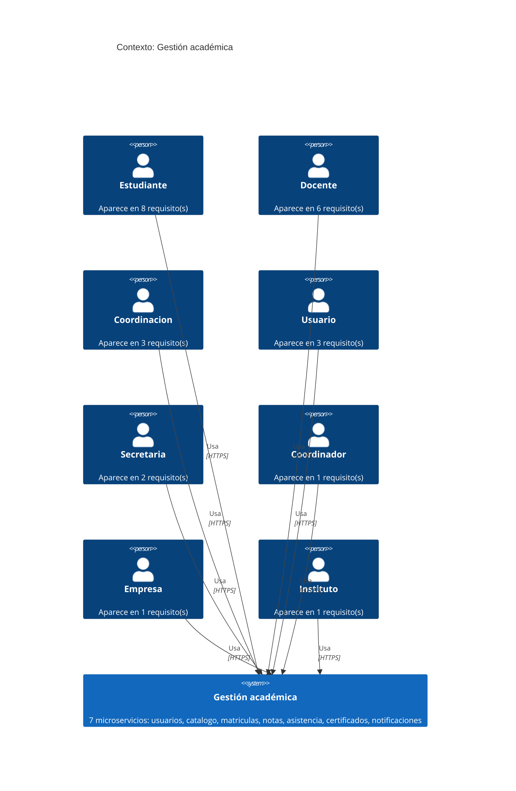
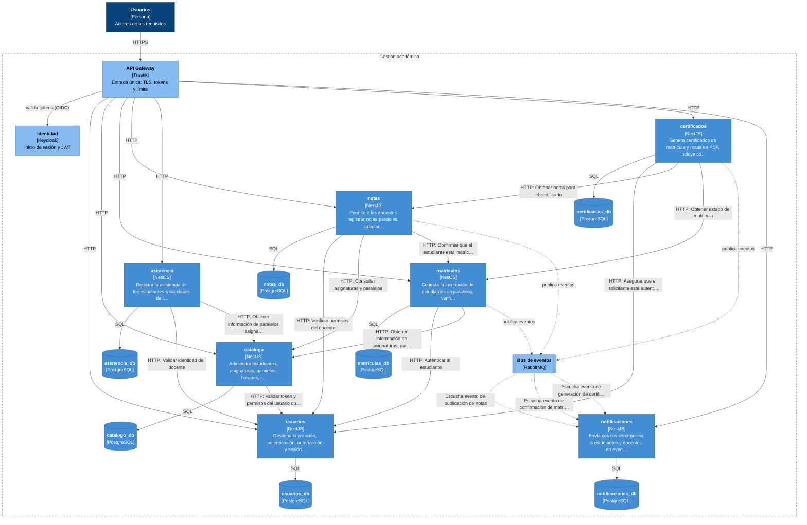

<!-- Generado por el framework (framework arquitectura adr). Se regenera: no lo edites. -->
# Arquitectura: Gestión académica

Generada el 2026-11-14 por el framework a partir de `arquitectura.json`, validada por OPA, para el documento requisitos.docx (SHA-256 `16229f92f991`). Los diagramas siguen el modelo C4 y GitHub los dibuja a partir del texto Mermaid.

Para regenerarla:

```bash
framework arquitectura diagrama <arquitectura.json> --requisitos <modelo_requisitos.json> --nombre "<nombre del sistema>"
```

## 1. Contexto

Quién usa el sistema. Los actores salen de los requisitos del documento.



## 2. Contenedores

Las piezas que forman el sistema y cómo se comunican. Las flechas «HTTP» entre servicios son llamadas síncronas (el que llama espera la respuesta); las «AMQP» pasan por el bus de eventos (el que publica no espera a nadie).



## 3. Servicios

| Servicio | Contexto | Responsabilidad | Base de datos | Requisitos | Etiquetas de seguridad |
|---|---|---|---|---|---|
| `usuarios` | Gestión de Identidad y Acceso | Gestiona la creación, autenticación, autorización y sesión de usuarios, aplica políticas de contraseñas, 2FA y controla perfiles y permisos. | `usuarios_db` | RF-02, RF-03, RF-04, RF-05, RF-06, RNF-01 | autorizacion, autenticacion, hash\_password, validacion\_entrada |
| `catalogo` | Catálogo Académico | Administra estudiantes, asignaturas, paralelos, horarios, requisitos previos, materiales y la integración con la biblioteca. Provee la oferta académica y permite la carga masiva de estudiantes. | `catalogo_db` | RF-01, RF-07, RF-08, RF-09, RF-10, RF-26, RF-28, RF-29, RF-32, RF-23 | validacion\_entrada, control\_acceso\_recursos |
| `matriculas` | Matrículas y Pago | Controla la inscripción de estudiantes en paralelos, verifica cupos, valida requisitos previos y horarios, gestiona cambios limitados y confirma la matrícula tras verificación de pago. | `matriculas_db` | RF-11, RF-12, RF-13, RF-14, RNF-02 | validacion\_entrada, limite\_peticiones |
| `notas` | Gestión de Calificaciones | Permite a los docentes registrar notas parciales, calcular promedios, publicar notas, auditar cambios, bloquear notas al cierre del periodo y generar reportes de desempeño. | `notas_db` | RF-16, RF-17, RF-18, RF-19, RF-20, RF-27 | validacion\_entrada, autorizacion, auditoria, control\_acceso\_recursos |
| `asistencia` | Control de Asistencia | Registra la asistencia de los estudiantes a las clases de los paralelos asignados y permite consultas de asistencia individual. | `asistencia_db` | RF-15 | ninguna |
| `certificados` | Emisión y Verificación de Certificados | Genera certificados de matrícula y notas en PDF, incluye código de verificación y permite a terceros validar su autenticidad. | `certificados_db` | RF-21, RF-22 | ninguna |
| `notificaciones` | Notificaciones y Mensajería | Envía correos electrónicos a estudiantes y docentes en eventos relevantes (publicación de notas, confirmación de matrícula, recordatorios). | `notificaciones_db` | RF-24, RF-25 | ninguna |

Requisitos transversales, que aplican a todo el sistema: RNF-03, RNF-04, RNF-05, RNF-06, RNF-07, RF-30, RF-31 (etiquetas: cifrado\_transito, punto\_unico\_acceso, limite\_peticiones).

## 4. Dependencias entre servicios

| Servicio | Depende de | Tipo | Para qué |
|---|---|---|---|
| `catalogo` | `usuarios` | síncrona (HTTP) | Validar token y permisos del usuario que realiza operaciones |
| `matriculas` | `usuarios` | síncrona (HTTP) | Autenticar al estudiante |
| `matriculas` | `catalogo` | síncrona (HTTP) | Obtener información de asignaturas, paralelos y requisitos |
| `notas` | `usuarios` | síncrona (HTTP) | Verificar permisos del docente |
| `notas` | `catalogo` | síncrona (HTTP) | Consultar asignaturas y paralelos |
| `notas` | `matriculas` | síncrona (HTTP) | Confirmar que el estudiante está matriculado |
| `asistencia` | `usuarios` | síncrona (HTTP) | Validar identidad del docente |
| `asistencia` | `catalogo` | síncrona (HTTP) | Obtener información de paralelos asignados |
| `certificados` | `usuarios` | síncrona (HTTP) | Asegurar que el solicitante está autenticado |
| `certificados` | `notas` | síncrona (HTTP) | Obtener notas para el certificado |
| `certificados` | `matriculas` | síncrona (HTTP) | Obtener estado de matrícula |
| `notificaciones` | `notas` | asíncrona (eventos) | Escucha evento de publicación de notas |
| `notificaciones` | `matriculas` | asíncrona (eventos) | Escucha evento de confirmación de matrícula |
| `notificaciones` | `certificados` | asíncrona (eventos) | Escucha evento de generación de certificado |

## 5. Patrones aplicados

| Patrón | Implementación | Por qué lo infiere OPA | ADR |
|---|---|---|---|
| Database per Service | prisma\_postgresql | Cada servicio tiene su propia base de datos | [ver ADR](adr/0004-aplicar-el-patron-database-per-service.md) |
| Event-Driven | rabbitmq | Dependencias por eventos: notificaciones -&gt; certificados, notificaciones -&gt; matriculas, notificaciones -&gt; notas | [ver ADR](adr/0005-aplicar-el-patron-event-driven.md) |
| API Gateway | traefik | Hay requisitos de autenticación y varios servicios: se autentica una sola vez, en la entrada; Hay requisitos de punto único de entrada o de límite de peticiones | [ver ADR](adr/0006-aplicar-el-patron-api-gateway.md) |
| Circuit Breaker | nestjs\_interceptor\_con\_reintentos\_y\_timeout | Llamadas síncronas entre servicios: asistencia -&gt; catalogo, asistencia -&gt; usuarios, catalogo -&gt; usuarios, certificados -&gt; matriculas, certificados -&gt; notas, certificados -&gt; usuarios, matriculas -&gt; catalogo, matriculas -&gt; usuarios, notas -&gt; catalogo, notas -&gt; matriculas, notas -&gt; usuarios | [ver ADR](adr/0007-aplicar-el-patron-circuit-breaker.md) |
| Saga | rabbitmq | asistencia, certificados, matriculas, notas coordina operaciones que involucran a otros servicios | [ver ADR](adr/0008-aplicar-el-patron-saga.md) |

## 6. Validación de OPA

Arquitectura aprobada: cumple los 4 criterios; patrones inferidos: api\_gateway, circuit\_breaker, database\_per\_service, event\_driven, saga

| Regla | Cumple | Detalle |
|---|---|---|
| `arquitectura.base_datos_propia` | sí | Cada servicio tiene su propia base de datos (Database per Service) |
| `arquitectura.sin_ciclos` | sí | Las llamadas síncronas entre servicios no forman ciclos |
| `arquitectura.dependencias_conocidas` | sí | Cada dependencia apunta a otro servicio de la arquitectura |
| `arquitectura.servicios_unicos` | sí | Hay al menos un servicio y no hay nombres repetidos |

Advertencias:

- `arquitectura.cadena_sincrona`: Cadena de llamadas síncronas asistencia -&gt; catalogo -&gt; usuarios: si usuarios falla o tarda, arrastra a los demás; considera eventos
- `arquitectura.cadena_sincrona`: Cadena de llamadas síncronas certificados -&gt; matriculas -&gt; catalogo: si catalogo falla o tarda, arrastra a los demás; considera eventos
- `arquitectura.cadena_sincrona`: Cadena de llamadas síncronas certificados -&gt; matriculas -&gt; usuarios: si usuarios falla o tarda, arrastra a los demás; considera eventos
- `arquitectura.cadena_sincrona`: Cadena de llamadas síncronas certificados -&gt; notas -&gt; catalogo: si catalogo falla o tarda, arrastra a los demás; considera eventos
- `arquitectura.cadena_sincrona`: Cadena de llamadas síncronas certificados -&gt; notas -&gt; matriculas: si matriculas falla o tarda, arrastra a los demás; considera eventos
- `arquitectura.cadena_sincrona`: Cadena de llamadas síncronas certificados -&gt; notas -&gt; usuarios: si usuarios falla o tarda, arrastra a los demás; considera eventos
- `arquitectura.cadena_sincrona`: Cadena de llamadas síncronas matriculas -&gt; catalogo -&gt; usuarios: si usuarios falla o tarda, arrastra a los demás; considera eventos
- `arquitectura.cadena_sincrona`: Cadena de llamadas síncronas notas -&gt; catalogo -&gt; usuarios: si usuarios falla o tarda, arrastra a los demás; considera eventos
- `arquitectura.cadena_sincrona`: Cadena de llamadas síncronas notas -&gt; matriculas -&gt; catalogo: si catalogo falla o tarda, arrastra a los demás; considera eventos
- `arquitectura.cadena_sincrona`: Cadena de llamadas síncronas notas -&gt; matriculas -&gt; usuarios: si usuarios falla o tarda, arrastra a los demás; considera eventos
