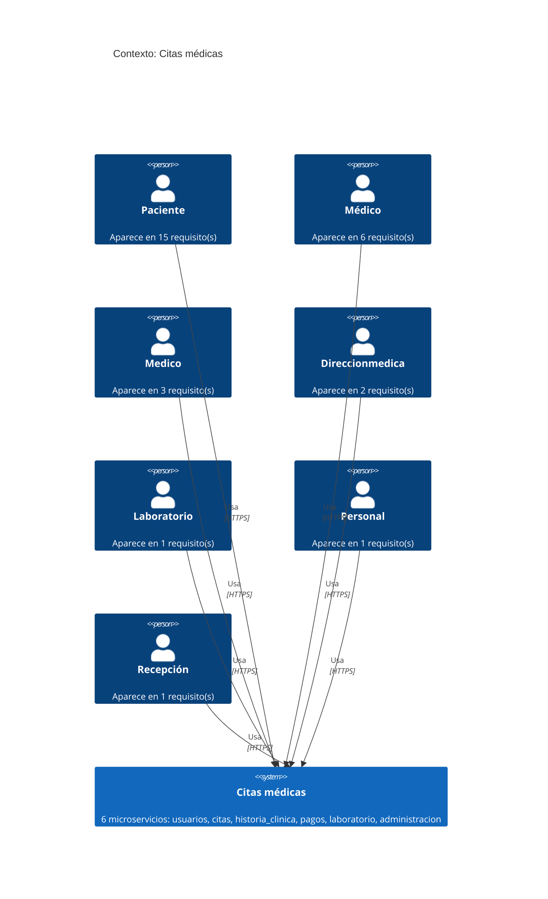
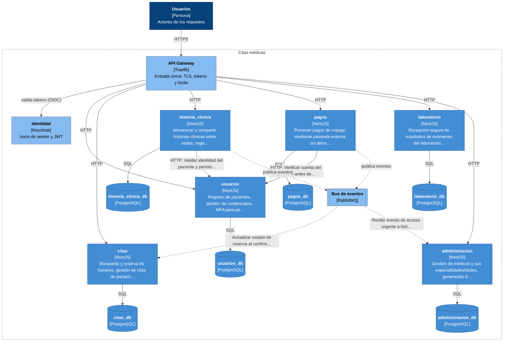

<!-- Generado por el framework (framework arquitectura adr). Se regenera: no lo edites. -->
# Arquitectura: Citas médicas

Generada el 2026-11-15 por el framework a partir de `arquitectura.json`, validada por OPA, para el documento requisitos.docx (SHA-256 `97afabd99b91`). Los diagramas siguen el modelo C4 y GitHub los dibuja a partir del texto Mermaid.

Para regenerarla:

```bash
framework arquitectura diagrama <arquitectura.json> --requisitos <modelo_requisitos.json> --nombre "<nombre del sistema>"
```

## 1. Contexto

Quién usa el sistema. Los actores salen de los requisitos del documento.



## 2. Contenedores

Las piezas que forman el sistema y cómo se comunican. Las flechas «HTTP» entre servicios son llamadas síncronas (el que llama espera la respuesta); las «AMQP» pasan por el bus de eventos (el que publica no espera a nadie).



## 3. Servicios

| Servicio | Contexto | Responsabilidad | Base de datos | Requisitos | Etiquetas de seguridad |
|---|---|---|---|---|---|
| `usuarios` | Gestión de usuarios y autenticación | Registro de pacientes, gestión de credenciales, MFA para personal, control de sesiones, corrección de datos personales y separación de frontends para pacientes y personal. | `usuarios_db` | RF-02, RF-28, RF-29, RNF-02, RNF-03, RNF-04 | autenticacion, validacion\_entrada, control\_acceso\_recursos, limite\_peticiones |
| `citas` | Gestión de citas y agenda | Búsqueda y reserva de horarios, gestión de citas de pacientes y sus hijos, evitar solapamientos, límites de citas pendientes, reglas de no‑show, cancelación y cambios, integración con pagos, teleconsulta, vista diaria del médico y envío de recordatorios. | `citas_db` | RF-01, RF-03, RF-04, RF-05, RF-06, RF-07, RF-08, RF-09, RF-10, RF-23, RF-26, RF-27 | control\_acceso\_recursos |
| `historia_clinica` | Historia clínica electrónica | Almacenar y compartir historias clínicas entre sedes, registro de consultas, notas, auditoría de accesos, control de acceso basado en citas, generación de PDF, recetas electrónicas, retención y cifrado de datos. | `historia_clinica_db` | RF-11, RF-12, RF-13, RF-14, RF-15, RF-16, RF-17, RNF-01, RNF-05 | autorizacion, auditoria, control\_acceso\_recursos |
| `pagos` | Gestión de pagos y reembolsos | Procesar pagos de copago mediante pasarela externa sin almacenar datos de tarjeta, recibir notificaciones de pagos, manejar reembolsos automáticos y validar notificaciones de la pasarela. | `pagos_db` | RF-20, RF-21, RF-22, RNF-07 | validacion\_entrada |
| `laboratorio` | Integración de resultados de laboratorio | Recepción segura de resultados de exámenes del laboratorio externo, almacenamiento de PDFs, disponibilidad resiliente y notificación a médicos y pacientes tras revisión. | `laboratorio_db` | RF-18, RNF-06 | autenticacion, validacion\_entrada |
| `administracion` | Gestión administrativa y reportes | Gestión de médicos y sus especialidades/sedes, generación de indicadores y reportes de ocupación, envío de notificaciones de resultados, control de acceso a reportes y auditoría de accesos urgentes, cumplimiento de políticas de contenido de recordatorios. | `administracion_db` | RF-19, RF-24, RF-25, RNF-08 | control\_acceso\_recursos, autorizacion |

Requisitos transversales, que aplican a todo el sistema: RF-30, RNF-09, RNF-10, RNF-11, RNF-12, RNF-13, RNF-14 (etiquetas: cifrado\_transito, punto\_unico\_acceso, limite\_peticiones).

## 4. Dependencias entre servicios

| Servicio | Depende de | Tipo | Para qué |
|---|---|---|---|
| `citas` | `pagos` | asíncrona (eventos) | Actualizar estado de reserva al confirmar o revertir el pago |
| `historia_clinica` | `usuarios` | síncrona (HTTP) | Validar identidad del paciente y permisos de acceso |
| `pagos` | `usuarios` | síncrona (HTTP) | Verificar cuenta del paciente antes de iniciar el pago |
| `administracion` | `historia_clinica` | asíncrona (eventos) | Recibir evento de acceso urgente a historia clínica para notificar a dirección médica |

## 5. Patrones aplicados

| Patrón | Implementación | Por qué lo infiere OPA | ADR |
|---|---|---|---|
| Database per Service | prisma\_postgresql | Cada servicio tiene su propia base de datos | [ver ADR](adr/0006-aplicar-el-patron-database-per-service.md) |
| Event-Driven | rabbitmq | Dependencias por eventos: administracion -&gt; historia\_clinica, citas -&gt; pagos | [ver ADR](adr/0007-aplicar-el-patron-event-driven.md) |
| API Gateway | traefik | Hay requisitos de autenticación y varios servicios: se autentica una sola vez, en la entrada; Hay requisitos de punto único de entrada o de límite de peticiones | [ver ADR](adr/0008-aplicar-el-patron-api-gateway.md) |
| Circuit Breaker | nestjs\_interceptor\_con\_reintentos\_y\_timeout | Llamadas síncronas entre servicios: historia\_clinica -&gt; usuarios, pagos -&gt; usuarios | [ver ADR](adr/0009-aplicar-el-patron-circuit-breaker.md) |

## 6. Validación de OPA

Arquitectura aprobada: cumple los 4 criterios; patrones inferidos: api\_gateway, circuit\_breaker, database\_per\_service, event\_driven

| Regla | Cumple | Detalle |
|---|---|---|
| `arquitectura.base_datos_propia` | sí | Cada servicio tiene su propia base de datos (Database per Service) |
| `arquitectura.sin_ciclos` | sí | Las llamadas síncronas entre servicios no forman ciclos |
| `arquitectura.dependencias_conocidas` | sí | Cada dependencia apunta a otro servicio de la arquitectura |
| `arquitectura.servicios_unicos` | sí | Hay al menos un servicio y no hay nombres repetidos |
