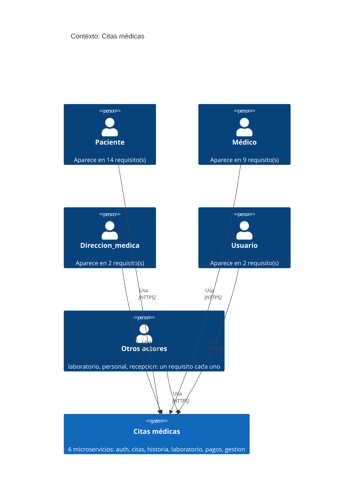
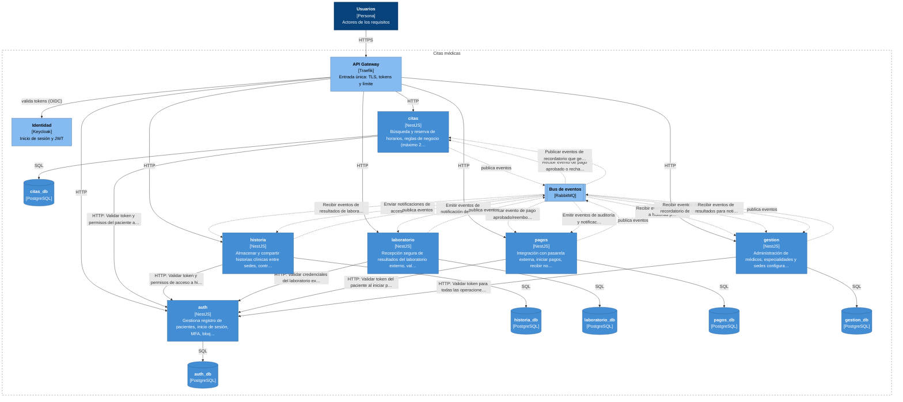

<!-- Generado por el framework (framework arquitectura adr). Se regenera: no lo edites. -->
# Arquitectura: Citas médicas

Generada el 2026-11-25 por el framework a partir de `arquitectura.json`, validada por OPA, para el documento requisitos.docx (SHA-256 `97afabd99b91`). Los diagramas siguen el modelo C4 y GitHub los dibuja a partir del texto Mermaid.

Para regenerarla:

```bash
framework arquitectura diagrama <arquitectura.json> --requisitos <modelo_requisitos.json> --nombre "<nombre del sistema>"
```

## 1. Contexto

Quién usa el sistema. Los actores salen de los requisitos del documento.



## 2. Contenedores

Las piezas que forman el sistema y cómo se comunican. Las flechas «HTTP» entre servicios son llamadas síncronas (el que llama espera la respuesta); las «AMQP» pasan por el bus de eventos (el que publica no espera a nadie).



## 3. Servicios

| Servicio | Contexto | Responsabilidad | Base de datos | Requisitos | Etiquetas de seguridad |
|---|---|---|---|---|---|
| `auth` | Autenticación y autorización | Gestiona registro de pacientes, inicio de sesión, MFA, bloqueo de cuenta, gestión de sesiones, emisión y validación de tokens. | `auth_db` | RF-03, RF-04, RF-06, RNF-01 | autenticacion, validacion\_entrada |
| `citas` | Gestión de citas y agenda | Búsqueda y reserva de horarios, reglas de negocio (máximo 2 pendientes, bloqueo por ausencias, cancelación, cambios), generación de eventos de pago, recordatorios, enlaces de teleconsulta y vista de agenda para médicos. | `citas_db` | RF-05, RF-08, RF-09, RF-10, RF-11, RF-12, RF-13, RF-28, RF-29, RF-32, RF-33 | autorizacion, control\_acceso\_recursos, validacion\_entrada |
| `historia` | Historia clínica electrónica | Almacenar y compartir historias clínicas entre sedes, control de acceso según citas, auditoría de accesos, notas inmutables, descarga PDF, retención cifrada 15 años. | `historia_db` | RF-01, RF-02, RF-14, RF-15, RF-16, RF-17, RF-18, RF-20, RNF-02 | autenticacion, hash\_password, cifrado\_transito, auditoria, control\_acceso\_recursos, validacion\_entrada, autorizacion |
| `laboratorio` | Resultados de laboratorio | Recepción segura de resultados del laboratorio externo, validación de autenticación, almacenamiento de PDFs y emisión de eventos de disponibilidad. | `laboratorio_db` | RF-21, RF-23 | autenticacion, validacion\_entrada |
| `pagos` | Gestión de pagos | Integración con pasarela externa, iniciar pagos, recibir notificaciones de pagos aprobados o reembolsados, emitir eventos y reembolsos automáticos. | `pagos_db` | RF-24, RF-25, RF-26, RF-27 | autorizacion, autenticacion, validacion\_entrada |
| `gestion` | Gestión operativa y notificaciones | Administración de médicos, especialidades y sedes; configuración de horarios; generación de reportes de ocupación; envío de notificaciones (recordatorios, avisos de acceso urgente); manejo de datos personales y cumplimiento de derechos; exposición de APIs diferenciadas para pacientes y personal. | `gestion_db` | RF-07, RF-19, RF-22, RF-30, RF-31, RF-34, RF-35, RF-36 | autorizacion, validacion\_entrada, control\_acceso\_recursos |

Requisitos transversales, que aplican a todo el sistema: RNF-03, RNF-04, RNF-05, RNF-06, RNF-07, RNF-08 (etiquetas: cifrado\_transito, punto\_unico\_acceso, limite\_peticiones).

## 4. Dependencias entre servicios

| Servicio | Depende de | Tipo | Para qué |
|---|---|---|---|
| `citas` | `auth` | síncrona (HTTP) | Validar token y permisos del paciente al crear o modificar citas |
| `citas` | `pagos` | asíncrona (eventos) | Recibir evento de pago aprobado o rechazado para confirmar o liberar la cita |
| `citas` | `gestion` | asíncrona (eventos) | Publicar eventos de recordatorio que gestión envía por correo/SMS |
| `historia` | `auth` | síncrona (HTTP) | Validar token y permisos de acceso a historias clínicas |
| `historia` | `laboratorio` | asíncrona (eventos) | Recibir eventos de resultados de laboratorio para asociarlos a la historia |
| `historia` | `gestion` | asíncrona (eventos) | Enviar notificaciones de accesos urgentes y auditoría |
| `laboratorio` | `auth` | síncrona (HTTP) | Validar credenciales del laboratorio externo al recibir resultados |
| `laboratorio` | `gestion` | asíncrona (eventos) | Emitir eventos de notificación de nuevo resultado para médicos |
| `pagos` | `auth` | síncrona (HTTP) | Validar token del paciente al iniciar pago |
| `pagos` | `citas` | asíncrona (eventos) | Publicar evento de pago aprobado/reembolsado que citas consume para confirmar o liberar horario |
| `pagos` | `gestion` | asíncrona (eventos) | Emitir eventos de auditoría y notificaciones de reembolso |
| `gestion` | `auth` | síncrona (HTTP) | Validar token para todas las operaciones de gestión |
| `gestion` | `historia` | asíncrona (eventos) | Recibir eventos de acceso a historias para generar avisos de urgencia |
| `gestion` | `citas` | asíncrona (eventos) | Recibir eventos de recordatorio de citas para enviar notificaciones |
| `gestion` | `laboratorio` | asíncrona (eventos) | Recibir eventos de resultados para notificar a médicos |

## 5. Patrones aplicados

| Patrón | Implementación | Por qué lo infiere OPA | ADR |
|---|---|---|---|
| Database per Service | prisma\_postgresql | Cada servicio tiene su propia base de datos | [ver ADR](adr/0006-aplicar-el-patron-database-per-service.md) |
| Event-Driven | rabbitmq | Dependencias por eventos: citas -&gt; gestion, citas -&gt; pagos, gestion -&gt; citas, gestion -&gt; historia, gestion -&gt; laboratorio, historia -&gt; gestion, historia -&gt; laboratorio, laboratorio -&gt; gestion, pagos -&gt; citas, pagos -&gt; gestion | [ver ADR](adr/0007-aplicar-el-patron-event-driven.md) |
| API Gateway | traefik | Hay requisitos de autenticación y varios servicios: se autentica una sola vez, en la entrada; Hay requisitos de punto único de entrada o de límite de peticiones | [ver ADR](adr/0008-aplicar-el-patron-api-gateway.md) |
| Circuit Breaker | nestjs\_interceptor\_con\_reintentos\_y\_timeout | Llamadas síncronas entre servicios: citas -&gt; auth, gestion -&gt; auth, historia -&gt; auth, laboratorio -&gt; auth, pagos -&gt; auth | [ver ADR](adr/0009-aplicar-el-patron-circuit-breaker.md) |
| Saga | rabbitmq | citas, gestion, historia, laboratorio, pagos coordina operaciones que involucran a otros servicios | [ver ADR](adr/0010-aplicar-el-patron-saga.md) |

## 6. Validación de OPA

Arquitectura aprobada: cumple los 4 criterios; patrones inferidos: api\_gateway, circuit\_breaker, database\_per\_service, event\_driven, saga

| Regla | Cumple | Detalle |
|---|---|---|
| `arquitectura.base_datos_propia` | sí | Cada servicio tiene su propia base de datos (Database per Service) |
| `arquitectura.sin_ciclos` | sí | Las llamadas síncronas entre servicios no forman ciclos |
| `arquitectura.dependencias_conocidas` | sí | Cada dependencia apunta a otro servicio de la arquitectura |
| `arquitectura.servicios_unicos` | sí | Hay al menos un servicio y no hay nombres repetidos |

Advertencias:

- `arquitectura.ciclo_de_eventos`: citas, gestion, historia, laboratorio, pagos dependen unos de otros en círculo (citas -&gt; gestion (asincrona), citas -&gt; pagos (asincrona), gestion -&gt; citas (asincrona), gestion -&gt; historia (asincrona), gestion -&gt; laboratorio (asincrona), historia -&gt; gestion (asincrona), historia -&gt; laboratorio (asincrona), laboratorio -&gt; gestion (asincrona), pagos -&gt; citas (asincrona), pagos -&gt; gestion (asincrona)): es una saga coreografiada; documenta sus eventos y la compensación si un paso falla
